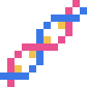
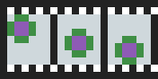
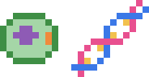
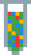
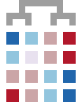

# Pixel icons

The pixel art used on [ank-agar.github.io](https://ank-agar.github.io). Feel free to use any of these.
The source maps live in `src/icons.mjs` of the site's source; each pixel is one letter in a palette.

|  | name | what it is |
|---|---|---|
|  | `sigma` | technical |
|  | `policy` | policy |
|  | `flask` | wet lab |
|  | `dna` | DNA |
|  | `film` | live-cell imaging |
|  | `cellgen` | cellular genetics |
|  | `omics` | single-cell omics |
|  | `helix` | protein |
|  | `heatmap` | AI bio methods |
|  | `egg` | Easter egg |
